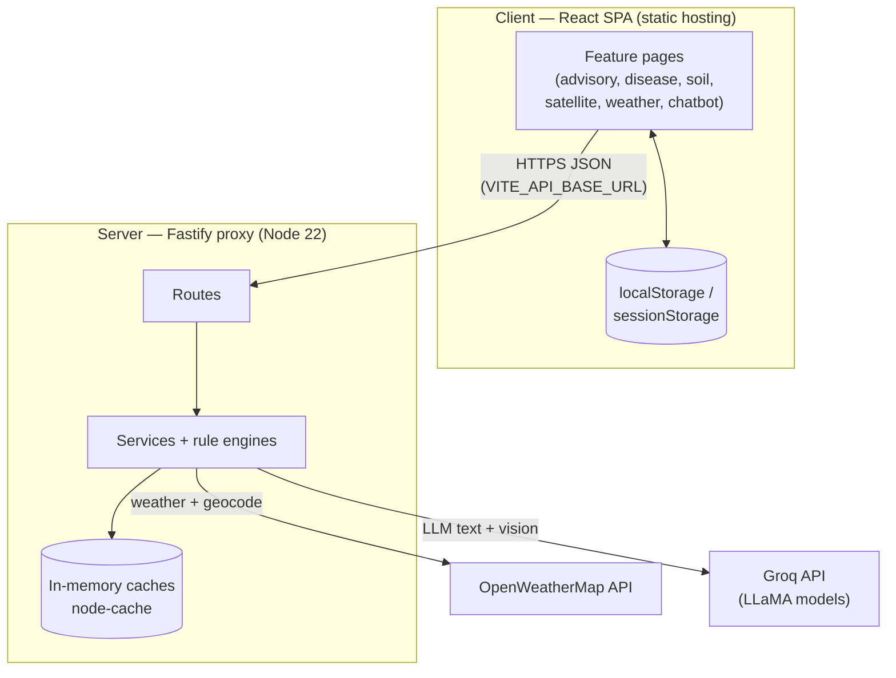
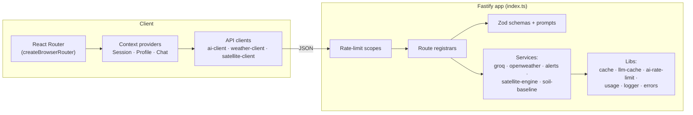

# AgriSmart — Project Knowledge Document

> A comprehensive, self-contained reference for AI assistants and developers. It is detailed
> enough to serve as the **primary context** for future development without needing to read the
> source first. Where a statement is an inference rather than a fact read directly from the code,
> it is marked **(inferred)**.

---

## Table of Contents

1. [Project Summary](#1-project-summary)
2. [Features](#2-features)
3. [Architecture](#3-architecture)
4. [Tech Stack](#4-tech-stack)
5. [Application Flow](#5-application-flow)
6. [Components / Modules](#6-components--modules)
7. [API Documentation](#7-api-documentation)
8. [Database / Persistence](#8-database--persistence)
9. [Authentication & Authorization](#9-authentication--authorization)
10. [Configuration](#10-configuration)
11. [Dependencies](#11-dependencies)
12. [External Integrations](#12-external-integrations)
13. [Important Algorithms](#13-important-algorithms)
14. [Coding Patterns](#14-coding-patterns)
15. [Build & Run Instructions](#15-build--run-instructions)
16. [Testing](#16-testing)
17. [Current Limitations](#17-current-limitations)
18. [Improvement Opportunities](#18-improvement-opportunities)
19. [AI Development Context](#19-ai-development-context)
20. [Glossary](#20-glossary)

---

## 1. Project Summary

- **Project name:** AgriSmart (client package `agrismart`, server package `agrismart-server`)
- **Purpose:** Put practical, agronomist-informed farming decisions in an Indian farmer's pocket —
  crop advisory, leaf-disease diagnosis, soil & fertilizer planning, hyperlocal weather with
  alerts, satellite-based moisture-stress detection, and a conversational AI assistant — in one
  multilingual web app.
- **Problem it solves:** Small and mid-size Indian farmers lack affordable, timely, localized
  agronomic guidance. Generic advice ignores their exact soil, season, budget, and weather.
  AgriSmart delivers ranked, honest, ₹-grounded recommendations in six Indian languages, with a
  rule-based foundation so it **always works** (even offline / without AI keys) and AI layers on
  top for richer, personalized advice.
- **High-level overview:** A monorepo with two independently deployable units:
  - **`client/`** — a React 19 + Vite single-page app (TypeScript, Tailwind). Static hosting.
  - **`server/`** — a Fastify 5 (TypeScript, ESM) API **proxy** that keeps provider API keys
    server-side and adds caching, rate-limiting, structured logging, schema validation, and
    graceful fallbacks. Deploys as a Node 22 service or Docker container.

  The design philosophy throughout is **"AI-enhanced, not AI-dependent"**: every AI feature has a
  deterministic rule-based fallback, and the satellite module is *entirely* rule-based (no LLM, no
  external API).



---

## 2. Features

### Implemented features

| Feature | Route | Backend | Fallback behaviour |
|---|---|---|---|
| **Crop Advisory** | `/app/advisory` | `POST /api/advisory/generate` (Groq text, grounded with live weather) | Requires Groq; returns 503 if unconfigured. Client also has an offline mock (`mock-api.ts`) using `data/advisory.json`. |
| **Leaf Disease Detector** | `/app/disease` | `POST /api/disease/analyze` (Groq vision) | Requires Groq; client downscales image before upload; server enforces safety gates. |
| **Soil & Fertilizer Plan** | `/app/soil` | `POST /api/soil/analyze` (rule baseline + Groq) | **Always** returns rule-engine baseline even when Groq is down/absent. |
| **Satellite Crop Advisory** | `/app/satellite` + public `/satellite` | `GET /api/satellite/*` (pure rule engine) | Always works — no API key, deterministic. |
| **Weather + Alerts** | `/app/weather` | `GET /api/weather/*`, `GET /api/geocode` (OpenWeatherMap) | Stale-cache serving; client `weather-fallback.ts` offline seed. |
| **AI Assistant (chatbot)** | `/app/chatbot` + floating panel | `POST /api/chat/message` (Groq text, profile+weather grounded) | Falls back to scripted offline replies (`chatbot-replies.json`) keyed by detected intent. |
| **Dashboard** | `/app/dashboard` | aggregates local + weather data | — |
| **History** | `/app/history` | localStorage (`agrismart.history`) | — |
| **KVK Directory** | `/app/kvk-directory` | static `kvkData.ts` + ICAR deep links | — |
| **Profile / Settings** | `/app/profile`, `/app/settings` | localStorage | — |
| **Six languages** | app-wide | i18n JSON dictionaries, lazy-loaded per locale + font | English bundled; others on demand |
| **Admin usage metrics** | — | `GET /api/admin/usage` (bearer token) | Token-gated; denies if `ADMIN_TOKEN` empty |
| **Public marketing landing** | `/` | static | — |
| **Public satellite landing** | `/satellite` | static + live demo calls | — |

Supported languages: **English (en), Hindi (hi), Kannada (kn), Tamil (ta), Telugu (te), Marathi (mr)**.

### Partially implemented / demo-grade

- **Authentication is a client-side mock.** Login/signup accept any email + any ≥6-char password,
  synthesize a display name from the email, and store a session object in `localStorage`. There is
  **no** server-side auth, password verification, token issuance, or user database. See
  [§9](#9-authentication--authorization).
- **Satellite data is synthesized fixtures.** Five fields with physically-plausible generated
  time-series (`server/src/data/satellite-fields.ts`). Not a live Sentinel/geospatial pipeline.
  The classifier is a nearest-centroid stand-in for a production RF/CNN model.
- **`mock-api.ts` legacy layer** still exists alongside the real API clients. The chatbot uses it
  as an offline fallback; some helpers (`getWeather`, `analyseLeaf`, `getAdvisory`) are legacy /
  back-compat and not the primary path.
- **Landing-page footer links** (About, Careers, Press, Docs, Community) are placeholder spans.

### Future-ready components already present

- **Multi-instance-aware config** — deployment guide explicitly notes the single-instance
  constraint and where a Redis shared store would slot in.
- **Server soil rule engine** (`soil-baseline.ts`) mirrors the client engine — ready to be the
  sole source of truth.
- **Satellite engine interface** (`classifyCrop` etc.) is deliberately model-agnostic so a trained
  classifier can be dropped in without touching routes or UI (documented in `docs/SATELLITE_ADVISORY.md`).
- **Usage/cost tracking** (`lib/usage.ts`) already tallies Groq tokens and estimated USD per model.

---

## 3. Architecture

### Overall architecture

A **two-tier monorepo**: a static SPA frontend and a stateless-ish (in-memory only) API proxy
backend. There is no shared database; the backend never persists data to disk. All user data lives
in the browser (`localStorage` / `sessionStorage`); all server state (caches, rate-limit counters,
chat history, usage tallies) is **in-memory** and ephemeral.

The backend exists primarily as a **secrets boundary and hardening layer** — it holds the
OpenWeatherMap and Groq keys, validates/schemas every request and every LLM response, rate-limits,
caches, and provides graceful degradation. The client never sees a provider key or domain.



### Design patterns used

- **Backend-for-frontend / API proxy** — server wraps third-party APIs behind its own contract.
- **Provider adapter / anti-corruption layer** — `openweather.ts` and `groq.ts` normalize raw
  provider payloads into internal types; raw shapes never leak to routes or client.
- **Result / discriminated-union returns** — services return `{ ok: true, data } | { ok: false, reason }`
  (`GroqResult<T>`) instead of throwing across boundaries; the app-wide response envelope is
  `{ ok: boolean, data?, reason? }`.
- **Schema-first validation** — Zod at every boundary: env (`config.ts`), request bodies, query
  params, **and LLM outputs** (with a strict-retry loop).
- **Strategy / rule-table** — weather alert rules, pesticide swaps, crop signatures, stage bands.
- **Defense-in-depth safety gates** — disease route re-applies safety rules after schema parse
  (`enforceDiseaseSafetyGates`) so a prompt/schema/model failure can't leak a dangerous chemical
  recommendation.
- **Graceful degradation** — stale-cache serving, rule-based fallbacks, offline mocks.
- **Lazy loading / code splitting** — routes, i18n dictionaries, and non-Latin fonts load on demand.
- **Provider/Context** — React context for session, profile, and chat.
- **Lazy singleton** — Groq SDK client instantiated on first use.

### Folder structure

```
agrismart/
├── README.md                      # Project overview + quickstart
├── DEPLOYMENT.md                  # Production deployment guide (env, Docker, scaling, CI)
├── note.txt                       # The originating problem statement (satellite PS)
├── .github/workflows/ci.yml       # CI: client + server typecheck + build on Node 22
├── docs/
│   ├── SATELLITE_ADVISORY.md      # Deep-dive on the satellite module + productionisation path
│   └── india.pdf                  # Presentation asset
│
├── client/                        # React + Vite SPA  →  builds to client/dist
│   ├── index.html                 # SPA entry HTML
│   ├── vite.config.ts             # Vite + manualChunks (recharts/framer/lucide/react-vendor)
│   ├── vercel.json                # SPA rewrite → /index.html
│   ├── public/_redirects          # Netlify SPA fallback
│   ├── tailwind.config.js, postcss.config.js, eslint.config.js
│   └── src/
│       ├── main.tsx               # ReactDOM root; imports i18n + globals.css
│       ├── app/                   # Cross-cutting app shell
│       │   ├── App.tsx            # Provider tree + RouterProvider + Toaster
│       │   ├── router.tsx         # createBrowserRouter; marketing vs /app trees; lazy routes
│       │   ├── session.tsx        # SessionProvider + ProtectedRoute (localStorage auth mock)
│       │   ├── profile.tsx        # ProfileProvider (farmer profile in localStorage)
│       │   ├── AppLayout.tsx      # Authenticated shell: sidebar + topbar + mobile nav
│       │   └── MarketingLayout.tsx# Public shell: marketing header + footer
│       ├── components/
│       │   ├── ui/                # Primitives: Button, Card, Input, Select, Tabs, Dialog, Chip, Logo
│       │   └── shared/            # AiDisclaimer, Avatar, ErrorBoundary, LanguageSwitcher, OfflineBanner
│       ├── features/              # ONE FOLDER PER FEATURE (see below)
│       ├── lib/                   # API clients, engines, utilities (see §6)
│       ├── data/                  # Offline JSON fixtures (advisory, diseases, chatbot-replies, weather.fallback)
│       ├── i18n/                  # index.ts + en/hi/kn/ta/te/mr.json dictionaries
│       └── styles/globals.css     # Tailwind layers + design tokens (brand/ink/surface)
│
└── server/                        # Fastify proxy  →  builds to server/dist
    ├── Dockerfile                 # Multi-stage Node 22 alpine, non-root, HEALTHCHECK /api/health
    ├── tsconfig.json
    └── src/
        ├── index.ts               # App bootstrap: CORS, rate-limit scopes, route registration, health, shutdown
        ├── config.ts              # Zod-validated env; isGroqConfigured / isPlaceholderKey sentinels
        ├── routes/                # One registrar per feature (weather, chat, advisory, soil, disease, satellite, admin)
        ├── services/              # Provider clients + rule engines (groq, openweather, alerts, satellite-engine, soil-baseline)
        ├── prompts/               # Zod schemas + system/user prompt builders (advisory, chatbot, disease, soil)
        ├── data/                  # satellite-fields.ts (observation fixtures + generator)
        ├── i18n/alerts.ts         # Localized weather-alert strings (6 langs)
        └── lib/                   # cache, llm-cache, ai-rate-limit, usage, logger, errors
```

**`client/src/features/` breakdown** (each is a self-contained feature module):

- `advisory/` — `AdvisoryPage.tsx` (~986 lines): multi-field form → ranked crop cards + strategies.
- `disease/` — `DiseasePage.tsx` (~953 lines): image upload/capture → confidence-driven diagnosis UI.
- `soil/` — `SoilPage.tsx`: NPK/pH/OC form → health score + eco recommendations + plan.
- `satellite/` — `SatellitePage.tsx` (dashboard) + `SatelliteLandingPage.tsx` (public).
- `weather/` — `WeatherPage.tsx` + `conditionIcon.tsx`; saved locations.
- `chatbot/` — `ChatContext.tsx` (state/provider), `ChatPanel.tsx` (floating), `ChatbotPage.tsx` (full page).
- `dashboard/`, `history/`, `profile/`, `settings/`, `kvk/`, `landing/`, `auth/`, `NotFound.tsx`.

### Important files & why they exist

| File | Why it exists |
|---|---|
| `server/src/index.ts` | Single bootstrap: wires CORS, layered rate-limits, all routes, health, graceful shutdown, crash nets. |
| `server/src/config.ts` | The app **refuses to start** on invalid env (Zod). Central sentinels for placeholder/missing keys. |
| `server/src/services/groq.ts` | The one place that talks to the LLM. Retry+backoff, error classification, JSON schema-validate-and-retry, PII-safe logging. |
| `server/src/services/satellite-engine.ts` | The deterministic domain core of the satellite module (classify/stage/stress/irrigate). |
| `server/src/routes/disease.ts` | Hosts `enforceDiseaseSafetyGates` — the safety-critical post-processing. |
| `client/src/app/router.tsx` | Defines the public vs authenticated route trees and lazy-loads every feature page. |
| `client/src/lib/ai-client.ts` | Typed client + `fileToDataUrl` (canvas downscale) + `X-User-Id` header. Mirrors server response types. |
| `client/src/i18n/index.ts` | Lazy dictionary + font loading strategy that keeps the English critical path small. |

---

## 4. Tech Stack

