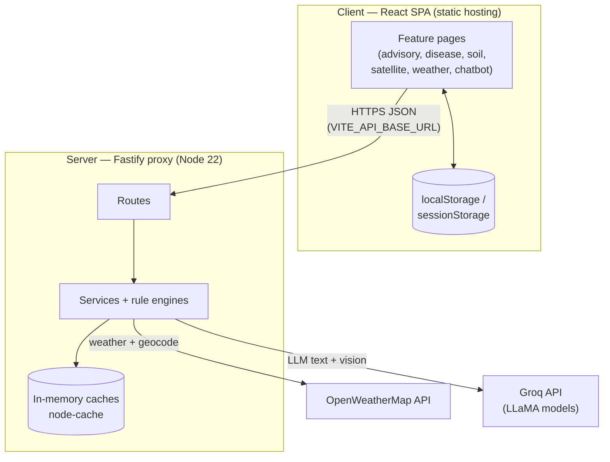
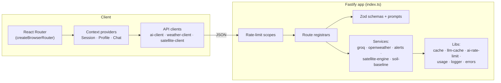
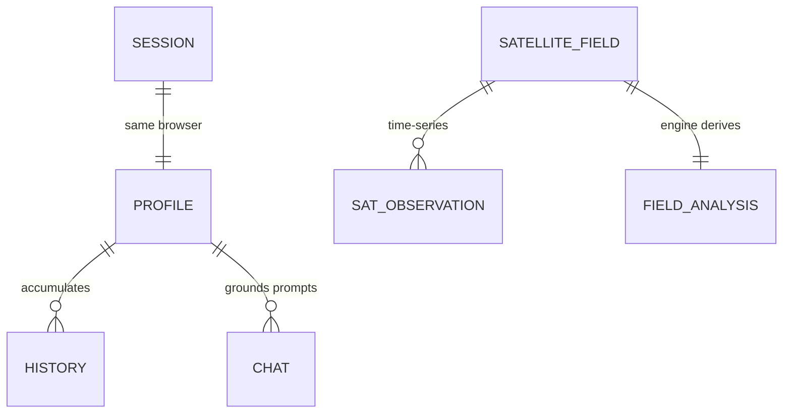

# AgriSmart — Project Knowledge Document

> A comprehensive, self-contained reference for AI assistants and developers. It is detailed
> enough to serve as the **primary context** for future development without needing to read the
> source first. Where a statement is an inference rather than a fact read directly from the code,
> it is marked **(inferred)**.

---

## Table of Contents

1. [Project Summary](#1-project-summary)
2. [Features](#2-features)
3. [Architecture](#3-architecture)
4. [Tech Stack](#4-tech-stack)
5. [Application Flow](#5-application-flow)
6. [Components / Modules](#6-components--modules)
7. [API Documentation](#7-api-documentation)
8. [Database / Persistence](#8-database--persistence)
9. [Authentication & Authorization](#9-authentication--authorization)
10. [Configuration](#10-configuration)
11. [Dependencies](#11-dependencies)
12. [External Integrations](#12-external-integrations)
13. [Important Algorithms](#13-important-algorithms)
14. [Coding Patterns](#14-coding-patterns)
15. [Build & Run Instructions](#15-build--run-instructions)
16. [Testing](#16-testing)
17. [Current Limitations](#17-current-limitations)
18. [Improvement Opportunities](#18-improvement-opportunities)
19. [AI Development Context](#19-ai-development-context)
20. [Glossary](#20-glossary)

---

## 1. Project Summary

- **Project name:** AgriSmart (client package `agrismart`, server package `agrismart-server`)
- **Purpose:** Put practical, agronomist-informed farming decisions in an Indian farmer's pocket —
  crop advisory, leaf-disease diagnosis, soil & fertilizer planning, hyperlocal weather with
  alerts, satellite-based moisture-stress detection, and a conversational AI assistant — in one
  multilingual web app.
- **Problem it solves:** Small and mid-size Indian farmers lack affordable, timely, localized
  agronomic guidance. Generic advice ignores their exact soil, season, budget, and weather.
  AgriSmart delivers ranked, honest, ₹-grounded recommendations in six Indian languages, with a
  rule-based foundation so it **always works** (even offline / without AI keys) and AI layers on
  top for richer, personalized advice.
- **High-level overview:** A monorepo with two independently deployable units:
  - **`client/`** — a React 19 + Vite single-page app (TypeScript, Tailwind). Static hosting.
  - **`server/`** — a Fastify 5 (TypeScript, ESM) API **proxy** that keeps provider API keys
    server-side and adds caching, rate-limiting, structured logging, schema validation, and
    graceful fallbacks. Deploys as a Node 22 service or Docker container.

  The design philosophy throughout is **"AI-enhanced, not AI-dependent"**: every AI feature has a
  deterministic rule-based fallback, and the satellite module is *entirely* rule-based (no LLM, no
  external API).



---

## 2. Features

### Implemented features

| Feature | Route | Backend | Fallback behaviour |
|---|---|---|---|
| **Crop Advisory** | `/app/advisory` | `POST /api/advisory/generate` (Groq text, grounded with live weather) | Requires Groq; returns 503 if unconfigured. Client also has an offline mock (`mock-api.ts`) using `data/advisory.json`. |
| **Leaf Disease Detector** | `/app/disease` | `POST /api/disease/analyze` (Groq vision) | Requires Groq; client downscales image before upload; server enforces safety gates. |
| **Soil & Fertilizer Plan** | `/app/soil` | `POST /api/soil/analyze` (rule baseline + Groq) | **Always** returns rule-engine baseline even when Groq is down/absent. |
| **Satellite Crop Advisory** | `/app/satellite` + public `/satellite` | `GET /api/satellite/*` (pure rule engine) | Always works — no API key, deterministic. |
| **Weather + Alerts** | `/app/weather` | `GET /api/weather/*`, `GET /api/geocode` (OpenWeatherMap) | Stale-cache serving; client `weather-fallback.ts` offline seed. |
| **AI Assistant (chatbot)** | `/app/chatbot` + floating panel | `POST /api/chat/message` (Groq text, profile+weather grounded) | Falls back to scripted offline replies (`chatbot-replies.json`) keyed by detected intent. |
| **Dashboard** | `/app/dashboard` | aggregates local + weather data | — |
| **History** | `/app/history` | localStorage (`agrismart.history`) | — |
| **KVK Directory** | `/app/kvk-directory` | static `kvkData.ts` + ICAR deep links | — |
| **Profile / Settings** | `/app/profile`, `/app/settings` | localStorage | — |
| **Six languages** | app-wide | i18n JSON dictionaries, lazy-loaded per locale + font | English bundled; others on demand |
| **Admin usage metrics** | — | `GET /api/admin/usage` (bearer token) | Token-gated; denies if `ADMIN_TOKEN` empty |
| **Public marketing landing** | `/` | static | — |
| **Public satellite landing** | `/satellite` | static + live demo calls | — |

Supported languages: **English (en), Hindi (hi), Kannada (kn), Tamil (ta), Telugu (te), Marathi (mr)**.

### Partially implemented / demo-grade

- **Authentication is a client-side mock.** Login/signup accept any email + any ≥6-char password,
  synthesize a display name from the email, and store a session object in `localStorage`. There is
  **no** server-side auth, password verification, token issuance, or user database. See
  [§9](#9-authentication--authorization).
- **Satellite data is synthesized fixtures.** Five fields with physically-plausible generated
  time-series (`server/src/data/satellite-fields.ts`). Not a live Sentinel/geospatial pipeline.
  The classifier is a nearest-centroid stand-in for a production RF/CNN model.
- **`mock-api.ts` legacy layer** still exists alongside the real API clients. The chatbot uses it
  as an offline fallback; some helpers (`getWeather`, `analyseLeaf`, `getAdvisory`) are legacy /
  back-compat and not the primary path.
- **Landing-page footer links** (About, Careers, Press, Docs, Community) are placeholder spans.

### Future-ready components already present

- **Multi-instance-aware config** — deployment guide explicitly notes the single-instance
  constraint and where a Redis shared store would slot in.
- **Server soil rule engine** (`soil-baseline.ts`) mirrors the client engine — ready to be the
  sole source of truth.
- **Satellite engine interface** (`classifyCrop` etc.) is deliberately model-agnostic so a trained
  classifier can be dropped in without touching routes or UI (documented in `docs/SATELLITE_ADVISORY.md`).
- **Usage/cost tracking** (`lib/usage.ts`) already tallies Groq tokens and estimated USD per model.

---

## 3. Architecture

### Overall architecture

A **two-tier monorepo**: a static SPA frontend and a stateless-ish (in-memory only) API proxy
backend. There is no shared database; the backend never persists data to disk. All user data lives
in the browser (`localStorage` / `sessionStorage`); all server state (caches, rate-limit counters,
chat history, usage tallies) is **in-memory** and ephemeral.

The backend exists primarily as a **secrets boundary and hardening layer** — it holds the
OpenWeatherMap and Groq keys, validates/schemas every request and every LLM response, rate-limits,
caches, and provides graceful degradation. The client never sees a provider key or domain.



### Design patterns used

- **Backend-for-frontend / API proxy** — server wraps third-party APIs behind its own contract.
- **Provider adapter / anti-corruption layer** — `openweather.ts` and `groq.ts` normalize raw
  provider payloads into internal types; raw shapes never leak to routes or client.
- **Result / discriminated-union returns** — services return `{ ok: true, data } | { ok: false, reason }`
  (`GroqResult<T>`) instead of throwing across boundaries; the app-wide response envelope is
  `{ ok: boolean, data?, reason? }`.
- **Schema-first validation** — Zod at every boundary: env (`config.ts`), request bodies, query
  params, **and LLM outputs** (with a strict-retry loop).
- **Strategy / rule-table** — weather alert rules, pesticide swaps, crop signatures, stage bands.
- **Defense-in-depth safety gates** — disease route re-applies safety rules after schema parse
  (`enforceDiseaseSafetyGates`) so a prompt/schema/model failure can't leak a dangerous chemical
  recommendation.
- **Graceful degradation** — stale-cache serving, rule-based fallbacks, offline mocks.
- **Lazy loading / code splitting** — routes, i18n dictionaries, and non-Latin fonts load on demand.
- **Provider/Context** — React context for session, profile, and chat.
- **Lazy singleton** — Groq SDK client instantiated on first use.

### Folder structure

```
agrismart/
├── README.md                      # Project overview + quickstart
├── DEPLOYMENT.md                  # Production deployment guide (env, Docker, scaling, CI)
├── note.txt                       # The originating problem statement (satellite PS)
├── .github/workflows/ci.yml       # CI: client + server typecheck + build on Node 22
├── docs/
│   ├── SATELLITE_ADVISORY.md      # Deep-dive on the satellite module + productionisation path
│   └── india.pdf                  # Presentation asset
│
├── client/                        # React + Vite SPA  →  builds to client/dist
│   ├── index.html                 # SPA entry HTML
│   ├── vite.config.ts             # Vite + manualChunks (recharts/framer/lucide/react-vendor)
│   ├── vercel.json                # SPA rewrite → /index.html
│   ├── public/_redirects          # Netlify SPA fallback
│   ├── tailwind.config.js, postcss.config.js, eslint.config.js
│   └── src/
│       ├── main.tsx               # ReactDOM root; imports i18n + globals.css
│       ├── app/                   # Cross-cutting app shell
│       │   ├── App.tsx            # Provider tree + RouterProvider + Toaster
│       │   ├── router.tsx         # createBrowserRouter; marketing vs /app trees; lazy routes
│       │   ├── session.tsx        # SessionProvider + ProtectedRoute (localStorage auth mock)
│       │   ├── profile.tsx        # ProfileProvider (farmer profile in localStorage)
│       │   ├── AppLayout.tsx      # Authenticated shell: sidebar + topbar + mobile nav
│       │   └── MarketingLayout.tsx# Public shell: marketing header + footer
│       ├── components/
│       │   ├── ui/                # Primitives: Button, Card, Input, Select, Tabs, Dialog, Chip, Logo
│       │   └── shared/            # AiDisclaimer, Avatar, ErrorBoundary, LanguageSwitcher, OfflineBanner
│       ├── features/              # ONE FOLDER PER FEATURE (see below)
│       ├── lib/                   # API clients, engines, utilities (see §6)
│       ├── data/                  # Offline JSON fixtures (advisory, diseases, chatbot-replies, weather.fallback)
│       ├── i18n/                  # index.ts + en/hi/kn/ta/te/mr.json dictionaries
│       └── styles/globals.css     # Tailwind layers + design tokens (brand/ink/surface)
│
└── server/                        # Fastify proxy  →  builds to server/dist
    ├── Dockerfile                 # Multi-stage Node 22 alpine, non-root, HEALTHCHECK /api/health
    ├── tsconfig.json
    └── src/
        ├── index.ts               # App bootstrap: CORS, rate-limit scopes, route registration, health, shutdown
        ├── config.ts              # Zod-validated env; isGroqConfigured / isPlaceholderKey sentinels
        ├── routes/                # One registrar per feature (weather, chat, advisory, soil, disease, satellite, admin)
        ├── services/              # Provider clients + rule engines (groq, openweather, alerts, satellite-engine, soil-baseline)
        ├── prompts/               # Zod schemas + system/user prompt builders (advisory, chatbot, disease, soil)
        ├── data/                  # satellite-fields.ts (observation fixtures + generator)
        ├── i18n/alerts.ts         # Localized weather-alert strings (6 langs)
        └── lib/                   # cache, llm-cache, ai-rate-limit, usage, logger, errors
```

**`client/src/features/` breakdown** (each is a self-contained feature module):

- `advisory/` — `AdvisoryPage.tsx` (~986 lines): multi-field form → ranked crop cards + strategies.
- `disease/` — `DiseasePage.tsx` (~953 lines): image upload/capture → confidence-driven diagnosis UI.
- `soil/` — `SoilPage.tsx`: NPK/pH/OC form → health score + eco recommendations + plan.
- `satellite/` — `SatellitePage.tsx` (dashboard) + `SatelliteLandingPage.tsx` (public).
- `weather/` — `WeatherPage.tsx` + `conditionIcon.tsx`; saved locations.
- `chatbot/` — `ChatContext.tsx` (state/provider), `ChatPanel.tsx` (floating), `ChatbotPage.tsx` (full page).
- `dashboard/`, `history/`, `profile/`, `settings/`, `kvk/`, `landing/`, `auth/`, `NotFound.tsx`.

### Important files & why they exist

| File | Why it exists |
|---|---|
| `server/src/index.ts` | Single bootstrap: wires CORS, layered rate-limits, all routes, health, graceful shutdown, crash nets. |
| `server/src/config.ts` | The app **refuses to start** on invalid env (Zod). Central sentinels for placeholder/missing keys. |
| `server/src/services/groq.ts` | The one place that talks to the LLM. Retry+backoff, error classification, JSON schema-validate-and-retry, PII-safe logging. |
| `server/src/services/satellite-engine.ts` | The deterministic domain core of the satellite module (classify/stage/stress/irrigate). |
| `server/src/routes/disease.ts` | Hosts `enforceDiseaseSafetyGates` — the safety-critical post-processing. |
| `client/src/app/router.tsx` | Defines the public vs authenticated route trees and lazy-loads every feature page. |
| `client/src/lib/ai-client.ts` | Typed client + `fileToDataUrl` (canvas downscale) + `X-User-Id` header. Mirrors server response types. |
| `client/src/i18n/index.ts` | Lazy dictionary + font loading strategy that keeps the English critical path small. |

---

## 4. Tech Stack

### Client

- **Language:** TypeScript (`~6.0.2` per package.json; ESM, `"type": "module"`).
- **Framework/Build:** React `19.2`, Vite `8`, `@vitejs/plugin-react`.
- **Routing:** `react-router-dom` v7 (`createBrowserRouter`).
- **Styling:** Tailwind CSS `3.4` + `@tailwindcss/forms` + `@tailwindcss/typography`, PostCSS, Autoprefixer.
- **Forms/Validation:** `react-hook-form` + `@hookform/resolvers` + **Zod v4**.
- **Charts:** `recharts` v3.
- **Animation:** `framer-motion` v12.
- **Icons:** `lucide-react`.
- **i18n:** `i18next` + `react-i18next`.
- **Toasts:** `sonner`.
- **Fonts:** `@fontsource/*` — Inter, Plus Jakarta Sans (Latin) + Noto Sans Devanagari/Kannada/Tamil/Telugu (lazy).
- **Utilities:** `clsx`, `tailwind-merge` (combined in `lib/utils.ts` as `cn`).
- **Lint:** ESLint 9 + `typescript-eslint` + React hooks/refresh plugins.

### Server

- **Language:** TypeScript `5.6` (ESM). Dev runtime `tsx watch`.
- **Framework:** Fastify `5`.
- **Fastify plugins:** `@fastify/cors`, `@fastify/rate-limit`.
- **LLM SDK:** `groq-sdk` (LLaMA 3.3 70B text; LLaMA 4 Scout 17B vision).
- **Validation:** **Zod v3** (note: server is Zod 3, client is Zod 4).
- **Caching:** `node-cache` (in-memory).
- **Logging:** `pino` (structured, with secret redaction).
- **Image sniffing:** `file-type` (magic-byte MIME check on disease uploads).
- **Env:** `dotenv`.

### Build tools & package managers

- **Package manager:** npm (per-package `package-lock.json`; no workspace root — each of `client/`
  and `server/` is installed and built independently).
- **Node:** 22+ required.
- **Client build:** `tsc -b && vite build` → `client/dist`.
- **Server build:** `tsc -p tsconfig.json` → `server/dist` (run with `node dist/index.js`).

### Databases

- **None.** No SQL/NoSQL database, no ORM, no migrations. Persistence is browser storage +
  ephemeral in-memory server caches. See [§8](#8-database--persistence).

### Infrastructure & deployment

- **Client:** static hosting (Vercel/Netlify configs included; SPA fallback to `index.html`).
- **Server:** Docker (multi-stage Node 22 alpine, non-root, healthcheck) or any Node 22 host.
- **CI:** GitHub Actions (`ci.yml`) — parallel client/server typecheck+build on Node 22.

---

## 5. Application Flow

### Startup

**Server (`server/src/index.ts`):**
1. `import 'dotenv/config'` (via `config.ts`) loads `.env`; Zod parses/validates env. **Invalid env
   → throw, process never starts.**
2. `main()` creates the Fastify instance with the pino logger and a 6 MB body limit (for base64
   disease images).
3. Registers CORS (allowed origins from `ALLOWED_ORIGIN`, comma-split), then a **global** rate
   limiter (60 req/IP/min).
4. Registers three isolated plugin scopes:
   - Weather scope (30 req/IP/min) → weather + geocode routes.
   - AI scope (30 req/IP/min) → chat, advisory, soil, disease routes.
   - Satellite scope (global limiter only) → satellite routes.
   - Admin routes.
5. Adds `GET /api/health` and `GET /` (route index). Warns if the OpenWeather key is a placeholder
   or Groq is unconfigured.
6. `app.listen({ port, host: '0.0.0.0' })`.
7. Registers `SIGTERM`/`SIGINT` graceful shutdown (drains in-flight requests via `app.close()`),
   plus `unhandledRejection`/`uncaughtException` crash nets.

**Client (`client/src/main.tsx`):**
1. Imports `./i18n` (initializes i18next, detects persisted language, lazy-loads dictionary+font if
   non-English) and `./styles/globals.css`.
2. Mounts `<App/>` into `#root` under `React.StrictMode`.
3. `App` renders provider tree: `SessionProvider → ProfileProvider → ChatProvider → RouterProvider`
   plus the global `Toaster`.

### Initialization / providers

- **SessionProvider** hydrates session from `localStorage['agrismart.session']`; syncs across tabs
  via the `storage` event.
- **ProfileProvider** hydrates the farmer profile from `localStorage['agrismart.profile']`;
  persists on every change.
- **ChatProvider** hydrates per-language chat transcripts from `localStorage['agrismart.chat']` and
  manages a persistent `conversation_id`.

### Authentication flow

Client-only mock (see [§9](#9-authentication--authorization)). `ProtectedRoute` guards `/app/*`:
if no `session.loggedIn`, redirect to `/login` preserving `from` for post-login redirect.

### Request flow (example: Crop Advisory)

```mermaid
sequenceDiagram
  participant U as User
  participant P as AdvisoryPage
  participant C as ai-client.ts
  participant R as routes/advisory.ts
  participant G as services/groq.ts
  participant W as services/openweather.ts
  participant X as Groq API

  U->>P: Fill form, submit
  P->>C: generateAdvisory(req)
  C->>R: POST /api/advisory/generate (+X-User-Id)
  R->>R: Zod-validate body
  R->>R: groqStatus.configured()? else 503
  R->>R: checkAiLimits() else 429
  R->>R: llmCache.get(key)? → return cached
  R->>W: weatherContextFor(location) (best-effort)
  W-->>R: "32°C, ~40mm next 5d" or undefined
  R->>G: callGroq(system, user, AdvisorySchema)
  G->>X: chat.completions.create (json_object)
  X-->>G: JSON
  G->>G: parse + Zod validate (+1 strict retry)
  G-->>R: {ok, data, usage}
  R->>R: trackUsage(); llmCache.set(key, data, 1 day)
  R-->>C: {ok:true, data, cached:false}
  C-->>P: Envelope
  P->>U: Render ranked crop cards
```

### Data flow

- **Inbound user data:** browser forms → typed client request → server Zod schema → service.
- **Provider data:** OpenWeatherMap/Groq → normalized in services → cached → returned as envelope.
- **Persistence:** results and history are written to `localStorage` on the client; the server
  keeps only ephemeral caches, rate counters, chat history, and usage tallies in memory.

### Business logic

- **Rule engines run first / always:** soil baseline computed before the LLM; satellite engine is
  100% deterministic; weather alerts derived by threshold rules.
- **LLM augments, never solely decides safety:** disease safety gates re-applied post-parse; soil
  health score always taken from the rule engine, not the LLM.

### External APIs

- **OpenWeatherMap** — current weather, 5-day forecast, geocoding (`services/openweather.ts`).
- **Groq** — text (advisory/soil/chat) and vision (disease) completions (`services/groq.ts`).

### Background jobs

- **None** (no schedulers/cron/queues). `node-cache` runs internal TTL sweep timers
  (`checkperiod`), but there are no application background jobs.

### Caching

Four in-memory `node-cache` instances (see [§8](#8-database--persistence)): weather fresh cache,
weather stale cache (6 h, for degradation), LLM output cache (advisory/soil 1 day, disease 7 days),
and per-conversation chat history + per-user weather-context cache in the chat route.

### Error handling

- Services throw typed errors (`UpstreamError`, `GroqError`) with a `reason`; routes map reasons →
  HTTP status and a `{ ok:false, reason }` envelope.
- Groq calls are wrapped in retry+backoff (1 s, 3 s) for retryable classes (5xx/429/network/timeout).
- LLM schema failures trigger one stricter retry, then return `schema_validation_failed`.
- Client wraps `fetch` so network errors surface as `{ ok:false, reason:'network_error' }`; UI
  degrades to fallbacks/toasts. `ErrorBoundary` catches render errors per route tree.

### Shutdown

`SIGTERM`/`SIGINT` → `app.close()` drains connections → `process.exit(0)`. Uncaught exceptions log
then exit 1.

---

## 6. Components / Modules

### Server modules

#### `config.ts`
- **Purpose:** Validate and expose all environment configuration.
- **Public interface:** `config` (typed, validated), `isPlaceholderKey`, `isGroqConfigured`.
- **Internal workflow:** Zod schema with defaults + transforms (string→number, URL checks);
  `safeParse` → throw on failure. Sentinels detect placeholder keys.

#### `services/groq.ts`
- **Purpose:** The sole LLM gateway (text + vision).
- **Responsibilities:** lazy client init, retry/backoff, error classification (`classify`), JSON
  extraction (`tryParseJson`, strips code fences / extracts first `{…}`), schema-validate with one
  stricter retry, token usage accounting, PII-safe logging (never logs prompt/response content).
- **Public interface:** `callGroq<T>(opts)`, `callGroqVision<T>(opts)`, `groqStatus.configured()`,
  `GroqResult<T>`, `TokenUsage`, `GroqError`.
- **Dependencies:** `groq-sdk`, `config`, `logger`, `zod`.

#### `services/openweather.ts`
- **Purpose:** Adapter for OpenWeatherMap current/forecast/geocode.
- **Responsibilities:** key-redacting fetch (`ow`), normalize raw payloads, bucket 3-hourly forecast
  into ≤5 daily summaries, fresh+stale caching with stale-serve on failure, reachability probe.
- **Public interface:** `getCurrentWeather`, `getForecast`, `geocode`, `isUpstreamReachable`, plus
  the normalized types (`CurrentWeather`, `ForecastResponse`, `ForecastDay`, `GeocodeResult`).

#### `services/alerts.ts`
- **Purpose:** Derive weather alerts from a forecast via threshold rules.
- **Internal workflow:** Rule table (heat_wave ≥38/41 °C, heavy_rain ≥50/100 mm, high_wind
  ≥12/18 m/s, cold_snap ≤5/2 °C); groups consecutive matching days into runs; localizes strings via
  `i18n/alerts.ts`.
- **Public interface:** `deriveAlerts(forecast, lang)`, `DerivedAlert`.

#### `services/satellite-engine.ts`
- **Purpose:** Deterministic crop/stage/stress/irrigation analysis. See [§13](#13-important-algorithms).
- **Public interface:** `classifyCrop`, `detectStage`, `detectMoistureStress`, `irrigationAdvisory`,
  `analyzeField`, `summarizeField`, `CROP_LIBRARY`, and all result types.
- **Dependencies:** only `data/satellite-fields.ts` types. No LLM, no network.

#### `services/soil-baseline.ts`
- **Purpose:** Rule-based soil health score + fertilizer/pesticide recommendation + 3-step plan.
  Ported from the client engine; used as LLM grounding **and** fallback.
- **Public interface:** `analyseSoil(input)`, `BaselineResult`.

#### `lib/` utilities
- `cache.ts` — fresh + stale `node-cache`, `cacheKey`, `storeBoth`.
- `llm-cache.ts` — LLM output cache, `llmCacheKey`, `sha256`, `ttl` helpers.
- `ai-rate-limit.ts` — per-user (60/h; chat 100/h) + per-IP (120/h) hourly counters + per-endpoint
  concurrency gate (max 20 concurrent). `identityFromReq`, `checkAiLimits`, `beginActive`/`endActive`.
- `usage.ts` — token + estimated-USD tallies per model; `trackUsage`, `usageSnapshot`.
- `logger.ts` — pino with aggressive secret redaction.
- `errors.ts` — `UpstreamError`, `statusForReason`.

#### `prompts/`
Each file exports: the input Zod schema, the output Zod schema (for structured features), and
`*SystemPrompt(lang)` / `*UserPrompt(input, …)` builders. These are the heart of AI behaviour and
encode safety rules, calibration, and language handling. Edit deliberately.

### Client modules (`lib/`)

| Module | Purpose |
|---|---|
| `ai-client.ts` | Typed POST client for chat/advisory/soil/disease; `X-User-Id` header; `fileToDataUrl` canvas downscale (≤1280px, JPEG 0.85). Types **mirror server schemas**. |
| `weather-client.ts` | Typed GET client for weather/forecast/alerts/geocode. |
| `satellite-client.ts` | Typed GET client for satellite overview/fields/analysis. |
| `soil-engine.ts` | Client-side soil rule engine (used by the offline mock path). |
| `mock-api.ts` | Legacy/offline layer: scripted advisory/disease/chat + weather bridge. Chatbot fallback. |
| `intent.ts` | Keyword intent detector (multilingual) for the offline chat fallback. |
| `history.ts` | localStorage history + soil-score trend. |
| `session-activity.ts` | sessionStorage recent-activity strip. |
| `settings.ts` | App settings in localStorage + `agrismart:settings` event. |
| `storage.ts` | Namespaced localStorage JSON helpers + `storageKeys`. |
| `constants.ts` | Indian states / cities / crops / fertilizers / pesticides lists. |
| `utils.ts` | `cn` (clsx+tailwind-merge), `clamp`, `wait`, `randomDelay`, `hashString`. |
| `weather-fallback.ts` | Deterministic offline weather seed. |

### Client app shell / contexts

- `session.tsx` — `SessionProvider`, `useSession`, `ProtectedRoute`.
- `profile.tsx` — `ProfileProvider`, `useProfile`, `FarmerProfile` type.
- `chatbot/ChatContext.tsx` — chat state, `send()` (real→fallback), per-language transcripts,
  conversation id, offline mock fallback.

---

## 7. API Documentation

**Base URL:** `VITE_API_BASE_URL` (default `http://localhost:4000`). **Auth:** none for feature
routes (an optional `X-User-Id` header keys AI rate-limits); bearer token only for `/api/admin/usage`.
**CORS:** methods `GET, POST`; allowed headers `Content-Type, Authorization, X-User-Id`.

**Common envelope:** success `{ ok: true, data, cached? }` (chat uses a flat shape); error
`{ ok: false, reason, details? }`.

### Health & meta

| Method | Path | Response |
|---|---|---|
| GET | `/api/health` | `{ ok, uptime_s, weather_configured, groq_configured }` |
| GET | `/` | `{ name, routes[], groq_configured }` |
| GET | `/api/weather/health` | `{ ok, upstream: 'reachable'|'unreachable', cached_keys }` |

### Weather (query params; 30 req/IP/min)

| Method | Path | Query | Notes |
|---|---|---|---|
| GET | `/api/weather/current` | `lat, lon, units?=metric, lang?=en` | Returns `CurrentWeather` |
| GET | `/api/weather/forecast` | same | ≤5 daily buckets |
| GET | `/api/weather/alerts` | same | `{ location, alerts[], source, cached, stale }` |
| GET | `/api/geocode` | `q, limit?=5 (1–10)` | `{ results[], source }` |

`lat ∈ [-90,90]`, `lon ∈ [-180,180]`, `lang ∈ {en,hi,kn,ta,te,mr}`.

### AI routes (POST JSON; 30 req/IP/min + service-layer hourly limits)

**`POST /api/chat/message`**
```jsonc
// Request
{ "conversation_id": "c_...", "message": "…(≤2000)", "lang": "en",
  "profile": { "name?":"", "state?":"", "district?":"", "village?":"",
               "farm_size_acres?":0, "primary_soil?":"", "secondary_soil?":"",
               "irrigation?":"", "primary_crops?":[] } }
// Success (flat, not data-wrapped)
{ "ok": true, "reply": "…", "tokens": 512, "grounded": true }
// LLM down: { "ok": true, "reply": "<localized fallback>", "fallback_used": true, "reason": "…" }
```

**`POST /api/advisory/generate`** — body = `AdvisoryInput` (`location`, `primary_soil`, optional
`secondary_soil`, `sowing_month`, `season`, `farm_size_acres`, `irrigation`, `budget_per_acre_inr`,
`risk_preference`, `experience`, `preferred_crops`, `previous_crop`, `lang`). Response `data` =
`AdvisoryResponse` (ranked `recommendations[]` with varieties/economics/timeline/requirements/risks,
`cropping_strategies[]`, `general_advice`, `caveats`, escalation flags). 503 if Groq unconfigured.

**`POST /api/soil/analyze`** — body = `SoilInput` (`nitrogen_kg_ha`, `phosphorus_kg_ha`,
`potassium_kg_ha`, `ph 3–10`, `organic_carbon_pct`, `intended_crop`, optional intended
fertilizer/pesticide, `lang`). Response `data` = `SoilResponse` (`soil_health_score` **from rule
engine**, `eco_fertilizer`, `eco_pesticide`, `improvement_plan[3]`, `warnings[]`). If Groq
unconfigured → 503 **with `baseline` attached**; if Groq errors mid-call → 200 with the rule-engine
baseline and `fallback_used: true`.

**`POST /api/disease/analyze`** — body `{ image_data_url: "data:image/(jpeg|png|webp);base64,…",
crop_context?, lang }`. Server checks size (≤6 MB base64), magic-byte MIME, then Groq vision.
Response `data` = `DiseaseResponse` (primary + differential diagnoses, calibrated confidence,
severity, structured treatment with gated `synthetic_chemical`, image-quality assessment,
escalation). **Safety gates re-applied server-side.** Errors: `413 image_too_large`,
`400 invalid_image`, `503 upstream_auth_failed`, `429`, `502`.

### Satellite (GET; global limiter only; always available)

| Method | Path | Description |
|---|---|---|
| GET | `/api/satellite/overview` | Region stats: total fields/area, stressed count, irrigation-needed count, crop distribution |
| GET | `/api/satellite/fields` | All fields as `FieldSummary[]` |
| GET | `/api/satellite/fields/:id` | Full `FieldAnalysis` (404 if unknown id) |

### Admin

| Method | Path | Auth | Response |
|---|---|---|---|
| GET | `/api/admin/usage` | `Authorization: Bearer <ADMIN_TOKEN>` (constant-time compare) | `usageSnapshot()` — per-model tokens, calls, estimated USD. `401` if token wrong/empty. |

### Error reasons (union)

`invalid_query`, `invalid_image`, `image_too_large`, `upstream_auth_failed`,
`upstream_rate_limited`, `upstream_unavailable`, `upstream_timeout`, `upstream_bad_request`,
`upstream_not_found`, `schema_validation_failed`, `user_rate_limited`, `ip_rate_limited`,
`server_busy`, `not_found`, `unauthorized`, `internal_error`, `network_error` (client), `unknown`.

---

## 8. Database / Persistence

**There is no database.** Persistence is split between the browser and ephemeral server memory.

### Client persistence (browser)

`localStorage`, all namespaced `agrismart.*` (`lib/storage.ts`):

| Key | Contents |
|---|---|
| `agrismart.lang` | Selected language code |
| `agrismart.session` | Mock session `{ loggedIn, name, email }` |
| `agrismart.profile` | `FarmerProfile` (name, phone, state, district, farmSize, crops, language) |
| `agrismart.history` | Last 50 `HistoryItem` (advisory/disease/soil) |
| `agrismart.chat` | Per-language chat transcripts + `agrismart.chat.cid` conversation id |
| `agrismart.soilScores` | Last 8 soil-score trend points |
| `agrismart.weather.saved` | Saved weather locations |
| `agrismart.settings` | App settings toggles |

`sessionStorage`: `agrismart.session_activity` (last 30 recent-activity entries; cleared on tab close).

### Server persistence (in-memory only — lost on restart)

| Store | TTL | Purpose |
|---|---|---|
| `cache` (weather) | `CACHE_TTL_SECONDS` (≥300, default 600) | Fresh weather/geocode |
| `staleCache` | 6 h | Degraded serving when upstream fails |
| `llmCache` | 1 day (advisory/soil), 7 days (disease) | Dedupe LLM calls by input hash |
| chat `conversations` | 1 h | Per-conversation last-20 turns |
| chat `weatherContextCache` | 10 min | Per-user weather grounding |
| `ai-rate-limit` counters | 1 h | Per-user/per-IP hourly limits |
| `usage` tallies | process lifetime | Token/cost accounting |

**Consequence (documented in DEPLOYMENT.md):** because cache and rate-limit state are in memory,
the server **must run as a single instance** unless a shared store (e.g. Redis) is added.

**No migrations, no schema files, no ORM.** The satellite "data" is generated fixtures
(`server/src/data/satellite-fields.ts`) with a seeded LCG so they never drift.

### Domain relationships (conceptual, not a DB)



---

## 9. Authentication & Authorization

> **Important:** Authentication is a **client-side demo/mock**. Treat this as a prototype boundary
> to harden, not production security.

### Login flow

1. `LoginPage`/`SignupPage` use `react-hook-form` + Zod (`email` valid, `password` ≥6 chars).
2. On submit: a 300 ms artificial delay, then a display name is derived from the email local-part;
   `useSession().login(name, email)` stores `{ loggedIn:true, name, email }` in `localStorage`.
3. **No network call, no password verification, no user record.** Any valid-format email + any
   ≥6-char password "logs in."
4. `ProtectedRoute` gates `/app/*`; unauthenticated users are redirected to `/login` (preserving
   `from`). Sessions sync across tabs via the `storage` event. Logout clears the key.

### Session / JWT handling

- **No JWT, no cookies, no server session.** The "session" is a plain JSON object in `localStorage`.
- The client sends `X-User-Id: <email|name>` on AI requests **only** to key server rate-limits — it
  is **not** an authentication credential and is not verified.

### Roles & permissions

- **No user roles.** All authenticated users see the same `/app` features.
- The only server-side authorization is the **admin bearer token** on `/api/admin/usage`
  (constant-time `timingSafeEqual`; denies when `ADMIN_TOKEN` is empty).

### Security mechanisms actually in place (server)

- Provider keys are server-only; the client never references a provider SDK/domain/key (enforced by
  convention + comments in client files).
- Zod-validated env (fail-fast) and Zod-validated request bodies/queries.
- Layered rate-limiting (global 60/IP/min; weather & AI scopes 30/IP/min; service-layer per-user/IP
  hourly + concurrency gate).
- CORS restricted to `ALLOWED_ORIGIN`.
- Structured logging with secret redaction; API keys redacted from URLs in logs.
- Disease upload hardening: size cap + magic-byte MIME sniff + safety gates.
- Body limit 6 MB; graceful shutdown; crash nets.

---

## 10. Configuration

### Server environment variables (validated by `config.ts`)

| Variable | Required | Default | Notes |
|---|---|---|---|
| `PORT` | no | `4000` | Listen port; binds `0.0.0.0` |
| `OPENWEATHER_API_KEY` | **yes** | — | Min length 10. Placeholder value rejected at runtime |
| `OPENWEATHER_BASE_URL` | no | `https://api.openweathermap.org/data/2.5` | |
| `OPENWEATHER_GEO_URL` | no | `https://api.openweathermap.org/geo/1.0` | |
| `ALLOWED_ORIGIN` | no | `http://localhost:5173` | Comma-separated CORS origins; **set to prod client URL** |
| `CACHE_TTL_SECONDS` | no | `600` | Min 300 |
| `LOG_LEVEL` | no | `info` | `trace…fatal` |
| `GROQ_API_KEY` | no | `''` | Enables AI features; must be >10 chars and not the placeholder |
| `GROQ_BASE_URL` | no | `https://api.groq.com` | SDK appends `/openai/v1` |
| `GROQ_MODEL_TEXT` | no | `llama-3.3-70b-versatile` | |
| `GROQ_MODEL_VISION` | no | `meta-llama/llama-4-scout-17b-16e-instruct` | |
| `GROQ_MAX_TOKENS` | no | `1024` (`.env.example` sets `4500`) | Max 8192; hard cap on completions |
| `GROQ_TIMEOUT_MS` | no | `30000` | Max 120000 |
| `ADMIN_TOKEN` | no | `''` | Bearer token for `/api/admin/usage`; empty = deny all |
| `NODE_ENV` | no | — | Set `production` in prod (Dockerfile does) |

### Client environment variables (Vite, **build-time** inlined)

| Variable | Required | Notes |
|---|---|---|
| `VITE_API_BASE_URL` | **yes** for prod | Public URL of the server. Defaults to `http://localhost:4000` in code |

### Config files

- `client/vite.config.ts` — React plugin + `manualChunks` (recharts, framer-motion, lucide-react,
  react-vendor) + 800 KB chunk warning limit.
- `client/tailwind.config.js`, `postcss.config.js`, `eslint.config.js`, `tsconfig*.json`.
- `client/vercel.json`, `client/public/_redirects` — SPA fallback.
- `server/tsconfig.json`, `server/Dockerfile`, `server/.dockerignore`.
- `.github/workflows/ci.yml`.

### Secrets required

`OPENWEATHER_API_KEY` (weather), `GROQ_API_KEY` (AI features), `ADMIN_TOKEN` (admin metrics).
**Deployment note:** keys were previously committed and must be rotated; the config layer rejects
the placeholder sentinels `REPLACE_WITH_YOUR_ROTATED_KEY` / `REPLACE_WITH_YOUR_ROTATED_GROQ_KEY`.

---

## 11. Dependencies

### Client — why each major dep is used

| Dependency | Why |
|---|---|
| `react` / `react-dom` 19 | UI framework |
| `react-router-dom` 7 | SPA routing (`createBrowserRouter`), lazy routes |
| `tailwindcss` (+forms, +typography) | Utility-first styling + design tokens |
| `react-hook-form` + `@hookform/resolvers` + `zod` | Performant forms with schema validation |
| `recharts` | Weather/soil/satellite charts |
| `framer-motion` | Page/element animation |
| `i18next` + `react-i18next` | Six-language runtime translation |
| `lucide-react` | Icon set |
| `sonner` | Toast notifications |
| `clsx` + `tailwind-merge` | `cn()` class composition |
| `@fontsource/*` | Self-hosted Latin + Indic fonts (lazy per language) |

### Server — why each major dep is used

| Dependency | Why |
|---|---|
| `fastify` 5 | HTTP framework (fast, schema-friendly, plugin scopes) |
| `@fastify/cors` | CORS restricted to allowed origins |
| `@fastify/rate-limit` | IP-level rate limiting per scope |
| `groq-sdk` | LLaMA text + vision completions |
| `zod` 3 | Env, request, and LLM-output validation |
| `node-cache` | In-memory caching + counters |
| `pino` | Structured JSON logging with redaction |
| `file-type` | Magic-byte MIME sniff for uploaded images |
| `dotenv` | Load `.env` |
| `tsx` (dev) | TS execution + watch in dev |

---

## 12. External Integrations

| Service | Used for | Where | Key | Failure handling |
|---|---|---|---|---|
| **OpenWeatherMap** | Current weather, 5-day/3-hour forecast, direct geocoding | `services/openweather.ts` | `OPENWEATHER_API_KEY` (server-only) | Typed `UpstreamError`; serve stale cache up to 6 h; key redacted from logs |
| **Groq** | LLaMA 3.3 70B (advisory/soil/chat text) + LLaMA 4 Scout 17B (disease vision) | `services/groq.ts` | `GROQ_API_KEY` (server-only) | Retry+backoff, error classification, schema-retry, feature-specific fallbacks; 503 when unconfigured |
| **ICAR KVK locator** | Deep links to verified KVK contacts | `features/kvk/kvkData.ts` | none | Static links to `kvk.icar.gov.in` |
| **OpenWeather icon CDN** | Weather condition icons | `openweather.ts` (`iconUrl`) | none | Image URLs only |

No payment gateway, no message broker, no analytics/telemetry SaaS, no cloud SDKs. Fonts are
self-hosted via `@fontsource` (no Google Fonts network dependency).

---

## 13. Important Algorithms

### Satellite crop classification (`satellite-engine.ts`)

Nearest-centroid over phenology signatures. Each reference crop (Rice, Wheat, Maize, Cotton,
Sugarcane) has a canonical NDVI-vs-day-after-sowing bell curve + early-season SAR VV level. For a
field:
1. Compute **RMSE** between observed NDVI trajectory and each crop's model curve (`modelNdvi`).
2. Add **SAR establishment distance** (flooded paddy sits several dB lower early in VV).
3. Add a **duration prior** penalty (a crop can't still be growing past its cycle length).
4. `dist = 3.0·shape + 1.4·earlyVV + 2.5·overrun`; **softmax** over `-dist` → calibrated
   probabilities. Top class + alternatives returned. Ground truth is compared only in the UI.

### Phenology / growth stage

Fraction through cycle `f = das / duration` maps to establishment (<0.12) → vegetative (<0.42) →
reproductive (<0.62) → maturity (<0.88) → harvest, cross-checked with a 3-pass NDVI trend
(rising/plateau/declining).

### Moisture-stress index (0–100)

```
index = 0.40·soilScore + 0.30·ndwiScore + 0.15·trendScore + 0.15·sarRatioScore
```
where components come from SAR-derived soil moisture, NDWI, 3-pass slopes, and the VV−VH ratio
(widens as canopies dry). Bands: none <20, mild 20–39, moderate 40–63, severe ≥64.

### Irrigation advisory

FAO-56-style stage crop coefficient `Kc` (establishment 0.45 → reproductive 1.15 → harvest 0.35)
sets a target root-zone moisture; deficit vs current SAR soil moisture drives depth (mm) and total
volume (1 mm over 1 ha = 10,000 L). Combined with the stress index it selects
`irrigate_now / irrigate_soon / adequate / reduce`, with priority and a natural-language rationale.

### Soil health score (`soil-baseline.ts` / `soil-engine.ts`)

Five equally-weighted (0.2 each) normalized sub-scores: N/80, P/60, K/80, pH proximity to 6.75, and
organic-carbon/1.0, each clamped to [0,1], ×100. Fertilizer choice is a priority cascade (low N →
high OC → low P → low K → balanced), plus pH lime/gypsum notes and a curated **pesticide-swap table**
(e.g. chlorpyrifos → 5% neem oil, monocrotophos → Trichogramma + Bt).

### Weather-alert derivation (`alerts.ts`)

Per rule (heat/rain/wind/cold), scan forecast days, group consecutive matches into runs, track the
peak value, and emit a localized alert with moderate/severe severity.

### LLM JSON hardening (`groq.ts`)

`tryParseJson` strips ```` ```json ```` fences and, failing that, extracts the first `{…}` block.
On Zod failure, one stricter retry (temperature 0.1 + "return ONLY the JSON object"); if still
invalid → `schema_validation_failed`. Token usage from both attempts is summed.

### Disease safety gates (`routes/disease.ts::enforceDiseaseSafetyGates`)

Post-parse: re-derive `confidence_label` from the numeric band; force `kvk_consultation_required =
true`; if `confidence < 0.7` or `severity = unable_to_assess`, scrub all synthetic-chemical
specifics; if recommended, ensure PPE minimums; if `not_a_leaf/healthy/uncertain`, block all
treatment. This makes "AI confidently recommends wrong dose" structurally impossible.

---

## 14. Coding Patterns

- **Naming:** camelCase for values/functions, PascalCase for types/React components; feature folders
  are lowercase; snake_case for JSON API fields and LLM schema fields (matches provider/domain
  conventions); files kebab-case (`ai-client.ts`) or PascalCase for components (`AppLayout.tsx`).
- **State management:** React Context for cross-cutting state (session, profile, chat); local
  component state elsewhere; **localStorage/sessionStorage** as the persistence layer. No Redux/Zustand.
- **Error handling:** typed error classes with `reason` codes across service boundaries; result
  unions rather than throws at the app boundary; client normalizes everything into
  `{ ok, data|reason }`.
- **Logging:** server-only, `pino` structured JSON, **PII-safe** (log tokens/model/duration, never
  prompt/response content), secrets redacted. No client logging framework.
- **Dependency injection:** none formal — modules import singletons (config, logger, caches). Groq
  client is a lazy singleton.
- **Validation:** Zod everywhere at boundaries (env, request, LLM output). Client forms use
  react-hook-form + Zod resolver.
- **Styling:** Tailwind utility classes + semantic design tokens (`brand`, `ink`, `surface`,
  `border`) defined in `globals.css`; `cn()` for conditional classes.
- **Performance:** route-level `lazy()` + `Suspense`; manual vendor chunk splitting; lazy i18n
  dictionaries and fonts; client image downscaling before upload; server caching + dedupe.
- **Comments:** substantial explanatory comments especially around safety gates, caching rationale,
  and prompt design — preserve these when editing.

---

## 15. Build & Run Instructions

### Prerequisites
- Node.js **22+**, npm. (Client `package.json` pins TypeScript ~6 and Vite 8; ensure a matching Node.)

### Backend
```bash
cd server
npm install
cp .env.example .env      # then fill values (at minimum OPENWEATHER_API_KEY)
npm run dev               # tsx watch → http://localhost:4000
```
Minimum env: `OPENWEATHER_API_KEY` (required). `GROQ_API_KEY` optional — without it, AI features
return 503 and the client falls back to rule-based/offline responses. Satellite needs **no** key.

### Frontend
```bash
cd client
npm install
npm run dev               # Vite → http://localhost:5173
```
Optional: `VITE_API_BASE_URL` (defaults to `http://localhost:4000`).

### Scripts
- **Client:** `npm run dev` · `npm run build` (`tsc -b && vite build`) · `npm run preview` · `npm run lint`
- **Server:** `npm run dev` · `npm run build` (`tsc`) · `npm start` (`node dist/index.js`) · `npm run typecheck`

### Production build
- **Client:** set `VITE_API_BASE_URL` to the prod server URL **before** building → deploy `client/dist`
  to static hosting with SPA fallback (Vercel/Netlify configs included).
- **Server:** `npm ci && npm run build && NODE_ENV=production node dist/index.js`, or use the Docker
  image (`docker build -t agrismart-server .`), passing env via secrets. **Run a single replica**
  (in-memory state). Health probe: `GET /api/health`.

### CI
`.github/workflows/ci.yml` runs on push/PR to `main`: parallel `client` and `server` jobs on Node
22, each `npm ci` → typecheck → build. Keep green before deploy.

---

## 16. Testing

- **There is currently no automated test suite** — no test framework (Jest/Vitest/Playwright), no
  `test` scripts, no `*.test.*` / `*.spec.*` files in the repo.
- **What stands in for tests today:** CI typecheck + build on both packages, and the fact that the
  satellite engine and soil engine are **pure, deterministic** functions (trivially unit-testable —
  see `docs/SATELLITE_ADVISORY.md`, which explicitly notes the engine "is fully unit-testable").
- **Recommended first tests (inferred priority):** `satellite-engine.ts` (classification/stress/
  irrigation math), `soil-baseline.ts` (scoring + swaps), `alerts.ts` (rule runs), `groq.ts`
  `tryParseJson` + schema-retry, and `enforceDiseaseSafetyGates` (safety-critical).

---

## 17. Current Limitations

- **No real authentication** — client-side mock only; any credentials pass. Not production-safe.
- **No database / no durable server state** — restart loses caches, chat history, rate counters,
  usage tallies. Forces single-instance deployment.
- **Satellite data is synthesized** — 5 demo fields, generated time-series, nearest-centroid
  classifier (not a trained model, not a live Sentinel pipeline).
- **Dual soil engines** — `client/lib/soil-engine.ts` and `server/services/soil-baseline.ts` are
  near-duplicates; drift risk (technical debt).
- **Legacy `mock-api.ts`** coexists with real clients; some helpers are dead/back-compat paths.
- **Zod version mismatch** — client Zod 4 vs server Zod 3 (intentional per-package, but a
  maintenance footgun).
- **No tests / no coverage.**
- **LLM cost & latency** — advisory/disease prompts are large; only input-hash caching mitigates.
- **Placeholder marketing links** and a hard-coded helpline/email in the footer.
- **Rate-limit & cache correctness break under horizontal scaling** (documented).
- **`GROQ_MAX_TOKENS` default drift** — code default 1024 vs `.env.example` 4500; advisory route
  requests 4500 but is clamped to the configured cap, so a low cap silently truncates rich outputs.

**TODOs/known-bug markers:** the codebase uses explanatory comments rather than `TODO` tags; the
main "known" items are the mock auth, single-instance constraint, and demo satellite data — all
called out in README/DEPLOYMENT/docs.

---

## 18. Improvement Opportunities

1. **Real auth** — replace the localStorage mock with a proper identity provider (JWT/OAuth or a
   managed auth service), server-verified sessions, and per-user data.
2. **Introduce a database** — persist profiles, history, chat, saved locations, and usage; enables
   multi-device and analytics. Add a shared cache/rate-limit store (Redis) to unlock horizontal
   scaling.
3. **Unify the soil engine** — delete the client duplicate; always call the server (with an offline
   fallback bundle if needed).
4. **Add tests** — start with the pure engines and safety gates; add API contract tests and a few
   Playwright smoke flows.
5. **Retire `mock-api.ts`** or formalize it as an explicit "offline mode" module with clear
   boundaries.
6. **Productionise satellite** — per `docs/SATELLITE_ADVISORY.md`: GEE/Sentinel Hub ingestion, SNAP
   SAR preprocessing, a trained RF/temporal-CNN classifier (interface already stable), farmer-drawn
   polygons, and a scheduled re-analysis job with push alerts.
7. **Observability** — export usage/latency metrics; alert on `schema_validation_failed` rates and
   upstream error spikes.
8. **Streaming chat** — stream Groq responses for perceived latency.
9. **Align Zod versions** and consider sharing types between client and server (a shared package).
10. **Fill marketing gaps** — real footer links, contact info.

---

