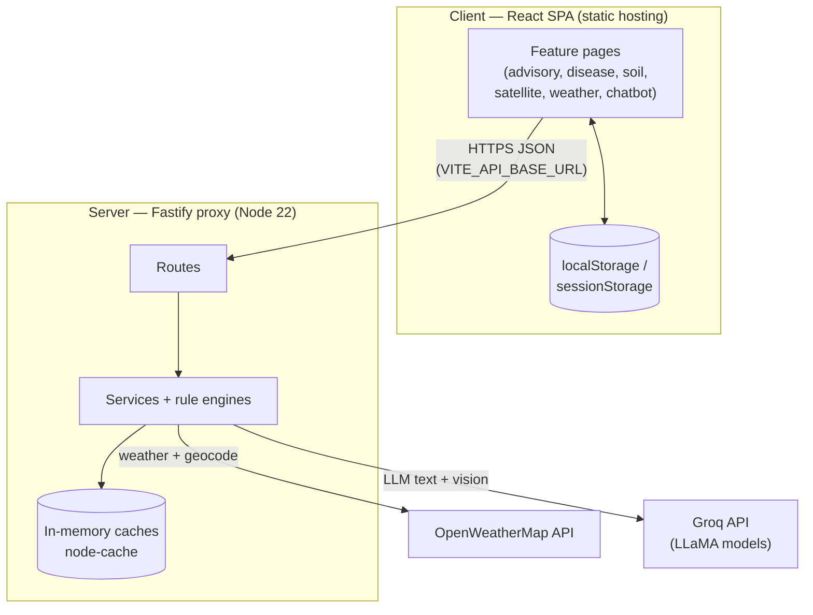
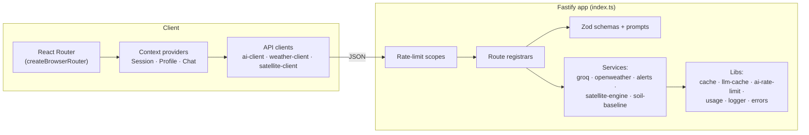

# AgriSmart — Project Knowledge Document

> A comprehensive, self-contained reference for AI assistants and developers. It is detailed
> enough to serve as the **primary context** for future development without needing to read the
> source first. Where a statement is an inference rather than a fact read directly from the code,
> it is marked **(inferred)**.

---

## Table of Contents

1. [Project Summary](#1-project-summary)
2. [Features](#2-features)
3. [Architecture](#3-architecture)
4. [Tech Stack](#4-tech-stack)
5. [Application Flow](#5-application-flow)
6. [Components / Modules](#6-components--modules)
7. [API Documentation](#7-api-documentation)
8. [Database / Persistence](#8-database--persistence)
9. [Authentication & Authorization](#9-authentication--authorization)
10. [Configuration](#10-configuration)
11. [Dependencies](#11-dependencies)
12. [External Integrations](#12-external-integrations)
13. [Important Algorithms](#13-important-algorithms)
14. [Coding Patterns](#14-coding-patterns)
15. [Build & Run Instructions](#15-build--run-instructions)
16. [Testing](#16-testing)
17. [Current Limitations](#17-current-limitations)
18. [Improvement Opportunities](#18-improvement-opportunities)
19. [AI Development Context](#19-ai-development-context)
20. [Glossary](#20-glossary)

---

## 1. Project Summary

- **Project name:** AgriSmart (client package `agrismart`, server package `agrismart-server`)
- **Purpose:** Put practical, agronomist-informed farming decisions in an Indian farmer's pocket —
  crop advisory, leaf-disease diagnosis, soil & fertilizer planning, hyperlocal weather with
  alerts, satellite-based moisture-stress detection, and a conversational AI assistant — in one
  multilingual web app.
- **Problem it solves:** Small and mid-size Indian farmers lack affordable, timely, localized
  agronomic guidance. Generic advice ignores their exact soil, season, budget, and weather.
  AgriSmart delivers ranked, honest, ₹-grounded recommendations in six Indian languages, with a
  rule-based foundation so it **always works** (even offline / without AI keys) and AI layers on
  top for richer, personalized advice.
- **High-level overview:** A monorepo with two independently deployable units:
  - **`client/`** — a React 19 + Vite single-page app (TypeScript, Tailwind). Static hosting.
  - **`server/`** — a Fastify 5 (TypeScript, ESM) API **proxy** that keeps provider API keys
    server-side and adds caching, rate-limiting, structured logging, schema validation, and
    graceful fallbacks. Deploys as a Node 22 service or Docker container.

  The design philosophy throughout is **"AI-enhanced, not AI-dependent"**: every AI feature has a
  deterministic rule-based fallback, and the satellite module is *entirely* rule-based (no LLM, no
  external API).

---

## 2. Features

### Implemented features

| Feature | Route | Backend | Fallback behaviour |
|---|---|---|---|
| **Crop Advisory** | `/app/advisory` | `POST /api/advisory/generate` (Groq text, grounded with live weather) | Requires Groq; returns 503 if unconfigured. Client also has an offline mock (`mock-api.ts`) using `data/advisory.json`. |
| **Leaf Disease Detector** | `/app/disease` | `POST /api/disease/analyze` (Groq vision) | Requires Groq; client downscales image before upload; server enforces safety gates. |
| **Soil & Fertilizer Plan** | `/app/soil` | `POST /api/soil/analyze` (rule baseline + Groq) | **Always** returns rule-engine baseline even when Groq is down/absent. |
| **Satellite Crop Advisory** | `/app/satellite` + public `/satellite` | `GET /api/satellite/*` (pure rule engine) | Always works — no API key, deterministic. |
| **Weather + Alerts** | `/app/weather` | `GET /api/weather/*`, `GET /api/geocode` (OpenWeatherMap) | Stale-cache serving; client `weather-fallback.ts` offline seed. |
| **AI Assistant (chatbot)** | `/app/chatbot` + floating panel | `POST /api/chat/message` (Groq text, profile+weather grounded) | Falls back to scripted offline replies (`chatbot-replies.json`) keyed by detected intent. |
| **Dashboard** | `/app/dashboard` | aggregates local + weather data | — |
| **History** | `/app/history` | localStorage (`agrismart.history`) | — |
| **KVK Directory** | `/app/kvk-directory` | static `kvkData.ts` + ICAR deep links | — |
| **Profile / Settings** | `/app/profile`, `/app/settings` | localStorage | — |
| **Six languages** | app-wide | i18n JSON dictionaries, lazy-loaded per locale + font | English bundled; others on demand |
| **Admin usage metrics** | — | `GET /api/admin/usage` (bearer token) | Token-gated; denies if `ADMIN_TOKEN` empty |
| **Public marketing landing** | `/` | static | — |
| **Public satellite landing** | `/satellite` | static + live demo calls | — |

Supported languages: **English (en), Hindi (hi), Kannada (kn), Tamil (ta), Telugu (te), Marathi (mr)**.

### Partially implemented / demo-grade

- **Authentication is a client-side mock.** Login/signup accept any email + any ≥6-char password,
  synthesize a display name from the email, and store a session object in `localStorage`. There is
  **no** server-side auth, password verification, token issuance, or user database. See
  [§9](#9-authentication--authorization).
- **Satellite data is synthesized fixtures.** Five fields with physically-plausible generated
  time-series (`server/src/data/satellite-fields.ts`). Not a live Sentinel/geospatial pipeline.
  The classifier is a nearest-centroid stand-in for a production RF/CNN model.
- **`mock-api.ts` legacy layer** still exists alongside the real API clients. The chatbot uses it
  as an offline fallback; some helpers (`getWeather`, `analyseLeaf`, `getAdvisory`) are legacy /
  back-compat and not the primary path.
- **Landing-page footer links** (About, Careers, Press, Docs, Community) are placeholder spans.

### Future-ready components already present

- **Multi-instance-aware config** — deployment guide explicitly notes the single-instance
  constraint and where a Redis shared store would slot in.
- **Server soil rule engine** (`soil-baseline.ts`) mirrors the client engine — ready to be the
  sole source of truth.
- **Satellite engine interface** (`classifyCrop` etc.) is deliberately model-agnostic so a trained
  classifier can be dropped in without touching routes or UI (documented in `docs/SATELLITE_ADVISORY.md`).
- **Usage/cost tracking** (`lib/usage.ts`) already tallies Groq tokens and estimated USD per model.

---

## 3. Architecture

### Overall architecture

A **two-tier monorepo**: a static SPA frontend and a stateless-ish (in-memory only) API proxy
backend. There is no shared database; the backend never persists data to disk. All user data lives
in the browser (`localStorage` / `sessionStorage`); all server state (caches, rate-limit counters,
chat history, usage tallies) is **in-memory** and ephemeral.

The backend exists primarily as a **secrets boundary and hardening layer** — it holds the
OpenWeatherMap and Groq keys, validates/schemas every request and every LLM response, rate-limits,
caches, and provides graceful degradation. The client never sees a provider key or domain.

